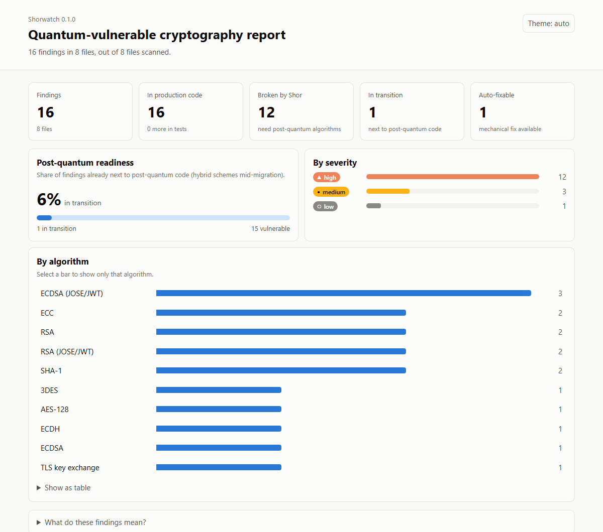
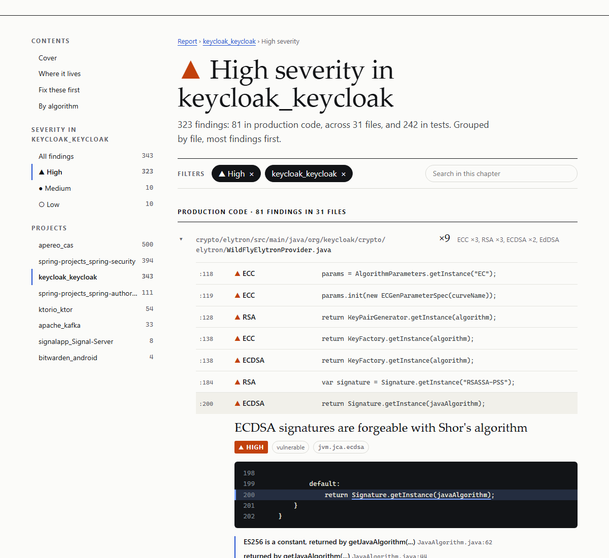

# Shorwatch

> Find quantum-vulnerable cryptography in your source code, and get a migration
> path to the NIST post-quantum standards.

Shorwatch is a static analyzer (SAST) written in Rust. It parses source code
into a syntax tree, matches it against declarative rules, and reports every use
of cryptography that a quantum computer would break or weaken, together with
the post-quantum replacement and the NIST standard behind it.

**Status: pre-alpha (v0.1 in progress).** The scanner works end to end on Java,
Kotlin and Spring projects; no release has been published yet. See
[Coverage](#coverage) for exactly what is and isn't detected.

## Why

Most public-key cryptography in production today (RSA, Diffie-Hellman,
elliptic curves) rests on problems that **Shor's algorithm** solves efficiently
on a large enough quantum computer. That day, often called *Q-Day*, may still
be years away, but the threat is already here:

- **Harvest now, decrypt later.** Encrypted traffic recorded today can be
  stored and decrypted once the hardware exists. Data that must stay secret
  for ten years is already exposed.
- **Migrations are slow.** Moving a codebase off RSA or ECDSA changes
  protocols, key sizes and wire formats. It takes years, so inventory has to
  start now.
- **The standards are final.** NIST published
  [FIPS 203 (ML-KEM)](https://csrc.nist.gov/pubs/fips/203/final) and
  [FIPS 204 (ML-DSA)](https://csrc.nist.gov/pubs/fips/204/final) in 2024, and
  [NIST IR 8547](https://csrc.nist.gov/pubs/ir/8547/ipd) sets the timeline to
  deprecate quantum-vulnerable algorithms.

The first step of any migration is knowing where the vulnerable crypto lives.
Shorwatch automates that inventory.

## What it detects

| Algorithm | Threat | Migrate to | Auto-fix |
|---|---|---|---|
| RSA | Shor | ML-KEM (FIPS 203) / ML-DSA (FIPS 204) | never |
| Diffie-Hellman | Shor | ML-KEM | never |
| ECDH, X25519, X448, ECIES | Shor | ML-KEM, e.g. hybrid X25519MLKEM768 | never |
| ECDSA | Shor | ML-DSA / SLH-DSA (FIPS 205) | never |
| Generic EC keys (`"EC"`) | Shor | ML-KEM or ML-DSA, depending on use | never |
| EdDSA (Ed25519, Ed448) | Shor | ML-DSA / SLH-DSA | never |
| DSA | Shor | ML-DSA | never |
| ElGamal | Shor | ML-KEM + AEAD | never |
| AES-128 | Grover | AES-256 | **yes** |
| SHA-1 | classical + Grover | SHA-256 / SHA3-256 | no |
| 3DES | Grover | AES-256-GCM | no |

The same algorithms are also detected inside **JWT/JOSE** (RS256, PS256,
ES256, EdDSA, RSA-OAEP, ECDH-ES, A128GCM, ...) with token-specific advice:
ML-DSA for JOSE, algorithm-agile verifiers and JWKS rotation.

Besides code and configuration, Shorwatch reads the **keys and certificates**
a repository holds: PEM and DER certificates, public and private keys, Java
keystores (JKS, JCEKS), PKCS#12 files and SSH keys. Each one is reported with
its subject, key size or curve, signature and expiry, e.g. `certificate
"CN=api.example.com": RSA 2048-bit, signed with SHA256withRSA, valid until
2031-03-01`.

Every finding carries the file, line, severity, an explanation, migration
advice and links to the relevant NIST documents.

### Design principles

- **Syntax tree, not grep.** Matching happens on the parsed code, so comments,
  log messages and look-alike names (`"ML-DSA"` is not DSA,
  `GCMParameterSpec(128)` is a tag length, not a key size) don't produce
  noise.
- **Hybrid-aware.** Classical crypto that sits next to post-quantum code
  (ML-KEM, ML-DSA, Kyber, Dilithium, BouncyCastle PQC, liboqs) is reported as
  **in transition** instead of vulnerable. Projects that are already migrating
  are recognized, not punished.
- **Auto-fix only where it is safe.** AES-128 → AES-256 is a parameter change,
  so Shorwatch can propose the edit. Replacing RSA or ECC changes the protocol,
  so that advice is always text for a human, never an automatic edit. The
  engine enforces this: a rule for a Shor-broken algorithm that declares a fix
  is rejected when the rules are loaded.
- **Rules are data.** Detections live in YAML files, so adding one never
  requires touching or recompiling the engine.

## Usage

Install it once, then run `shorwatch` from any project:

```sh
cargo install --path shorwatch-cli          # until the first release is published
```

```sh
shorwatch                                    # scan the current project: counts, and a link to the HTML report
shorwatch report                             # scan and open the HTML report in the browser
shorwatch --watch                            # scan again whenever a file changes
shorwatch open                               # open the last report again, without scanning
shorwatch ci                                 # in a pipeline: SARIF + HTML, linked from the log
shorwatch baseline                           # record today's findings: later scans report only new ones

shorwatch services/                          # a folder of services: one group per project
shorwatch --overview                         # the files with findings, the most urgent explained
shorwatch --details                          # every finding, explained
shorwatch src/ config/ --compact             # several paths, one line per finding
shorwatch --format cbom -o crypto.cdx.json   # CycloneDX CBOM inventory
shorwatch --fail-severity high               # only high and critical findings fail
shorwatch --rules ./company-rules/           # add your own YAML rules
shorwatch --classpath @cp.txt                # follow calls into compiled dependencies
shorwatch rules                              # list the rules in effect
```

Without a command, `shorwatch` is `shorwatch scan` (which scripts may keep
using; a folder named like a command, say `report/`, is scanned with
`shorwatch scan report/`). A scan walks the given paths respecting
`.gitignore`, analyzes `.java`, `.kt`, `.kts`, `.yml`, `.yaml` and
`.properties` files in parallel, and resolves `@Value("${...}")` injections
against the project's configuration files. Key material is read from `.pem`,
`.crt`, `.cer`, `.der`, `.key`, `.pub`, `.csr`, `.jks`, `.jceks`, `.keystore`,
`.truststore`, `.p12` and `.pfx` files, told apart by content.

| Option | |
|---|---|
| `--format text\|sarif\|cbom\|json\|markdown\|html` | Output format (default `text`, coloured on terminals) |
| `-o, --output FILE` | Write the report to a file |
| `--min-severity info\|low\|medium\|high\|critical` | Hide less severe findings |
| `--html FILE` | Also write the HTML report there, whatever the format |
| `--no-html` | Do not write the HTML report to a temporary folder (see below) |
| `--open` | Open the HTML report in the browser when the scan ends (`shorwatch report` does it) |
| `--watch` | Scan again whenever a scanned file changes, until Ctrl+C |
| `--report-url URL` | The link shown for the HTML report, e.g. where CI publishes it (also `SHORWATCH_REPORT_URL`) |
| `--fail-on vulnerable\|any\|never` | When to exit with code 1 (default: any finding still `vulnerable`; `never` only reports) |
| `--fail-severity info\|low\|medium\|high\|critical` | Only findings at or above this severity fail the scan; the rest are still reported |
| `--exclude-tests` | Skip test code (Maven/Gradle test source sets such as `src/test` or `src/jvmTest`, test directories, `*Test`/`*IT` classes). Without it, findings in test code are reported and labelled as such |
| `--overview` | List the files with findings and explain the three most urgent |
| `--details` | Explain every finding |
| `--compact` | One line per finding |
| `--rules DIR` | Extra rules directory (repeatable) |
| `--classpath PATHS` | Compiled dependencies to read types from (see below) |

Exit codes: `0` nothing failing, `1` failing findings, `2` error. See
[In CI pipelines](#in-ci-pipelines).

### Baseline and suppressions

A first scan of an existing project finds what years of code hold. To adopt
Shorwatch without fixing everything first, record a baseline and commit it:

```sh
shorwatch baseline        # writes shorwatch-baseline.json
```

Scans run from the same folder read it and report only **new** findings;
the known ones are counted, not hidden (`not counted: 412 known from the
baseline`), and `--no-baseline` shows everything again. A finding is known by
its rule, its file and the code on its line, so edits elsewhere in the file
keep it known; record the baseline again as findings are fixed.

To accept a single finding, say why next to it:

```java
// shorwatch:ignore jvm.jca.rsa -- partner API requires RSA until Q3
KeyPairGenerator.getInstance("RSA");
```

```yaml
jws-algorithms: RS256 # shorwatch:ignore rsa -- legacy mobile clients
```

The comment goes on the finding's line or alone on the line above. Name
rules by id or by profile (`rsa` covers every `*.rsa` rule), or none for
every rule on that line; the reason after `--` travels into the reports. To
skip whole files (test certificates, vendored code), list them in a
`.shorwatchignore` file, in `.gitignore` syntax.

Every report counts what was left out and why. In SARIF the suppressed
findings are still results, marked with `suppressions` (`inSource` with the
reason, or `external` for the baseline), as the SARIF standard describes;
the CBOM, an inventory, still lists their algorithms.

### Compiled dependencies (`--classpath`)

Sources say `jsch.getSession(host).apply { setConfig("kex", ...) }`; only the
library knows that `getSession` returns a `Session`. With `--classpath`,
Shorwatch reads the class files of the dependencies (signatures only: no
code is run or analyzed) and follows calls through library types. Without
it, everything else works the same.

```sh
# Maven: the project's resolved dependencies
mvn dependency:build-classpath -Dmdep.outputFile=cp.txt
shorwatch --classpath @cp.txt

# Any directory of jars or classes, and the JDK's own modules
shorwatch --classpath build/libs --classpath "$JAVA_HOME/jmods"
```

Entries are directories (searched for `.class`, `.jar` and `.jmod` files),
jars and jmods, separated like `CLASSPATH` (`:`, or `;` on Windows), or
`@file` listing them. Only the types the project's call chains reach are
kept, so a large classpath costs mostly the time to read it (about 2 s for
a 1 GB Maven repository).

### Example output

Scanning [`examples/spring-service`](examples/spring-service/), a small Spring
Boot service. The terminal only counts, as test runners do, and links the
HTML report, where findings are browsed (on an interactive terminal, the
report is written to the system's temporary folder and overwritten by the
next scan of the same project; `--html FILE` puts it elsewhere, `--no-html`
skips it). Some terminals, VS Code's among them, open a `file://` link as
text in the editor: `shorwatch report` (or `--open`) opens the report in the
default browser when the scan ends, `shorwatch open` afterwards.

```text
 Summary  17 findings in 9 files (9 scanned)
          13 high · 3 medium · 1 low
          16 vulnerable · 1 in transition · 1 auto-fixable

 Report   file:///tmp/shorwatch/spring-service.html

 → shorwatch open  open it in your browser
 → --details  every finding, here

 ✖ 16 findings fail the scan (exit code 1) · see --fail-on, --fail-severity
```

For the terminal, `--overview` lists the files with findings (production code
first, one line each, grouped by project when there are several) and
explains the three most urgent; `--details` explains every finding (where,
why it matters, what to do); `--compact` gives one line per finding.

```text
 ▲ apereo_cas                                   500 findings · 79 in production · 449 high · 42 medium · 9 low
   ▲ support/…/jwks/OidcJwksRegistrationEndpointController.java    6  ECDSA (JOSE/JWT) ×2, EdDSA (JOSE/JWT) ×…
   ▲ support/…/authentication/TokenAuthenticationSecurity.java     6  RSA (JOSE/JWT) ×4, ECDH (JOSE/JWE), ECD…
   …
 ▲ signalapp_Signal-Server                      8 findings · 6 in production · 7 high · 1 medium
   ▲ service/src/main/…/gcp/CanonicalRequestSigner.java         3  RSA ×3
   ▲ service/src/main/…/push/apns-certificates.pem              1  RSA
   …
```

Every format for that scan is in [`examples/output/`](examples/output/):
[text](examples/output/report.txt) (also [--overview](examples/output/report-overview.txt) and [--details](examples/output/report-details.txt)), [SARIF](examples/output/report.sarif),
[CBOM](examples/output/report.cdx.json), [JSON](examples/output/report.json),
[Markdown](examples/output/report.md), [HTML](examples/output/report.html).

### HTML report

`--format html` (or `--html FILE` next to any other format) writes one
self-contained audit report to open in a browser or keep as a CI artifact. It
reads like a printed audit: a cover with the headline numbers, where the
findings live (projects or files), the three to fix first with their code and
data-flow path, and the breakdown by algorithm and severity.



Every number is a way in. Selecting a severity, an algorithm or a project
opens a chapter: production code grouped by file (25 at a time), test code
folded, each finding opening in place with its code, the path its value
takes, why it matters and what to do. Chapters and findings have their own
links (`#/findings?sev=high&project=billing&f=12`), so the page never turns
into one endless scroll and any finding can be shared.



Each finding opens where you work on it. The report a scan writes for your
terminal has **Open in VS Code**, straight to the line and column; reports
saved with `--html` or `--format html` leave it out, since it would carry
your machine's paths to whoever receives the file. A report written by
`shorwatch ci` links **View on GitHub** (or GitLab) at the scanned commit,
the lines highlighted, and **Open in github.dev**, the editor in the
browser.

A scan of several projects (a folder of services or repositories) ranks them
on the cover, and each gets its chapters. The page is plain HTML, CSS and
script with the data embedded: no framework, no fonts or anything else from
the network (a Content-Security-Policy forbids it), light and dark themes,
print styles.


### Cryptography Bill of Materials (CBOM)

`--format cbom` emits a [CycloneDX 1.6](https://cyclonedx.org/capabilities/cbom/)
CBOM, the inventory format used by the post-quantum ecosystem (PQCA tooling
such as CBOMkit). Each algorithm becomes a `cryptographic-asset` with its
primitive, parameters and **NIST quantum security level**, and every place it
occurs is listed as evidence:

```json
{
  "type": "cryptographic-asset",
  "bom-ref": "crypto/algorithm/aes-128",
  "name": "AES-128",
  "cryptoProperties": {
    "assetType": "algorithm",
    "algorithmProperties": {
      "primitive": "block-cipher",
      "parameterSetIdentifier": "128",
      "cryptoFunctions": ["keygen", "encrypt", "decrypt"],
      "classicalSecurityLevel": 128,
      "nistQuantumSecurityLevel": 1
    }
  },
  "evidence": {
    "occurrences": [
      {
        "location": "examples/spring-service/src/main/java/com/example/payments/crypto/LegacyCrypto.java",
        "line": 22,
        "additionalContext": "jvm.jca.aes-128 (vulnerable)"
      }
    ]
  }
}
```

SARIF answers *what must be fixed and where*; the CBOM answers *what
cryptography the system contains*. The CBOM is validated against the official
CycloneDX 1.6 schema and is deterministic (no timestamp or random serial
number). Today it inventories the quantum-vulnerable algorithms Shorwatch
detects; quantum-safe algorithms are not listed yet.

### In CI pipelines

`shorwatch ci` is the scan for pipelines. It writes `shorwatch-report/`
(`report.sarif` for code scanning tools, `report.html` for people; another
folder with `--out-dir`), prints the summary in the log with a link to the
HTML report, and, on GitHub Actions, adds it to the job summary, every
location linked to its lines at the scanned commit. It knows
where GitHub Actions, GitLab CI, Jenkins and Azure Pipelines serve a job's
artifacts, so the link works once the folder is published; elsewhere, pass
it with `--report-url` (or `SHORWATCH_REPORT_URL`).

When the scan fails, the last line of the log says why and links the report:

```text
 Summary  17 findings in 9 files (9 scanned)
          13 high · 3 medium · 1 low
          16 vulnerable · 1 in transition · 1 auto-fixable

 Report   https://github.com/acme/payments/actions/runs/912345678

 ✖ 16 findings fail the scan (exit code 1) · see --fail-on, --fail-severity
   Report https://github.com/acme/payments/actions/runs/912345678
```

Exit code `1` fails the build when it finds cryptography still vulnerable;
`2` means the scan could not run (bad arguments, invalid rules, unreadable
paths). Gating is a choice:

| | |
|---|---|
| `--fail-on never` | Report only, never fail: a first run, or a dashboard |
| `--fail-severity high` | Fail on high and critical findings; medium and low are still reported |
| `--fail-on any` | Also fail on findings already in transition (hybrid) |
| `--exclude-tests` | Leave test code out of the scan, and of the gate |
| `shorwatch-baseline.json` | Fail only on findings that are new since the baseline was recorded (see [Baseline and suppressions](#baseline-and-suppressions)) |

Publish the folder even when the scan fails (`if: always()`, `when: always`,
`post { always }`, `condition: always()` below).

### GitHub Actions

SARIF results show up as code scanning alerts on the exact line of a pull
request; the HTML report is an artifact of the run, linked from the log and
the job summary:

```yaml
# .github/workflows/shorwatch.yml
name: Shorwatch
on: [push, pull_request]
permissions:
  contents: read
  actions: read
  security-events: write
jobs:
  scan:
    runs-on: ubuntu-latest
    steps:
      - uses: actions/checkout@v4
      - uses: dtolnay/rust-toolchain@stable
      - run: cargo install --git https://github.com/ErwinQuantum/shorwatch shorwatch-cli
      - run: shorwatch ci --fail-severity high
      - uses: github/codeql-action/upload-sarif@v4
        if: always()
        with:
          sarif_file: shorwatch-report/report.sarif
      - uses: actions/upload-artifact@v4
        if: always()
        with:
          name: shorwatch-report
          path: shorwatch-report/
```

### Docker (Jenkins, Azure DevOps, GitLab CI)

The image needs no Rust toolchain: a static binary on Alpine (~23 MB).
On Linux CI agents it scans as fast as the native binary (Keycloak, 9,000
files: ~4 s). Docker Desktop on Windows and macOS shares host folders slowly
(the same scan takes ~20 s); there, prefer the native binary.

```sh
docker run --rm -v "$PWD:/src" ghcr.io/erwinquantum/shorwatch ci
```

The CI variables the link is built from must reach the container: GitLab
runs the job inside the image; with `docker run`, pass them with `-e`.

Jenkins, with the [Warnings Next Generation](https://plugins.jenkins.io/warnings-ng/)
plugin reading the SARIF report and the HTML report archived with the build:

```groovy
stage('Post-quantum crypto') {
    steps {
        sh 'docker run --rm -v "$WORKSPACE:/src" -e JENKINS_URL -e BUILD_URL ghcr.io/erwinquantum/shorwatch ci --fail-severity high'
    }
    post {
        always {
            recordIssues tool: sarif(pattern: 'shorwatch-report/report.sarif', id: 'shorwatch', name: 'Shorwatch')
            archiveArtifacts artifacts: 'shorwatch-report/**'
        }
    }
}
```

Jenkins serves archived files under a strict Content-Security-Policy that
blocks scripts, the report's included: configure a
[resource root URL](https://www.jenkins.io/doc/book/security/user-content/#resource-root-url)
(Jenkins' own recommendation for user content) or download the file.

Azure DevOps, with the [SARIF SAST Scans Tab](https://marketplace.visualstudio.com/items?itemName=sariftools.scans)
extension (it reads the `CodeAnalysisLogs` artifact):

```yaml
- script: |
    docker run --rm -v "$(Build.SourcesDirectory):/src" \
      -e TF_BUILD -e SYSTEM_COLLECTIONURI -e SYSTEM_TEAMPROJECT -e BUILD_BUILDID \
      ghcr.io/erwinquantum/shorwatch ci --fail-severity high
- publish: shorwatch-report/report.sarif
  artifact: CodeAnalysisLogs
  condition: always()
- publish: shorwatch-report
  artifact: shorwatch-report
  condition: always()
```

GitLab CI, where the job's artifacts open in the browser:

```yaml
shorwatch:
  image:
    name: ghcr.io/erwinquantum/shorwatch
    entrypoint: [""]
  script:
    - shorwatch ci --fail-severity high
  artifacts:
    when: always
    expose_as: Shorwatch report
    paths: [shorwatch-report/]
```

## Coverage

Java and Kotlin source code and its configuration (`application.yml`,
`.properties`). Rules are written per platform, not per language: one JVM rule
covers both, and every Java test fixture has a Kotlin twin that must produce
the same findings.

| Covered today | Not yet |
|---|---|
| JCA / JCE: `KeyPairGenerator`, `KeyFactory`, `Cipher`, `Signature`, `KeyAgreement`, `MessageDigest`, `KeyGenerator`, `SecretKeyFactory`, key and parameter specs | Groovy and Scala |
| BouncyCastle lightweight API (engines, signers, generators) and PKIX certificate signing (`JcaContentSignerBuilder`) | `@ConfigurationProperties` binding |
| JWT/JOSE: jjwt (0.11 and 0.12), Nimbus JOSE + JWT, Auth0 java-jwt | Algorithms chosen at runtime, e.g. from a remote JWKS |
| Spring Security: OAuth2 JOSE constants, `NimbusJwtDecoder.withPublicKey`, `RsaKeyConverters`, spring-security-rsa | Quarkus and Micronaut configuration keys |
| Spring Boot config: `jws-algorithms`, `public-key-location`, TLS cipher suites (`*.ssl.ciphers`); Spring Cloud Config encryption keys; app keys like `jwt.algorithm: RS256` | Crypto inside compiled `.jar` dependencies (their types are read with `--classpath`, their code is not analyzed) |
| Values injected with `@Value("${key:default}")`, resolved against every profile's config file | |
| Apache Commons Codec and Guava (SHA-1), `net.i2p` (EdDSA) | |
| OpenPGP (BouncyCastle `bcpg`): key, hash and symmetric algorithm tags | The algorithm of keys read from existing key rings |
| SSH: JSch key types and `setConfig` algorithm lists, Apache MINA SSHD signature and key-exchange factories, host key algorithms | Library defaults when nothing is configured |
| XML Signature and Encryption (SAML, WS-Security): JSR 105 `SignatureMethod`/`DigestMethod`, Apache Santuario, OpenSAML `SignatureConstants`/`EncryptionConstants` | Algorithm URIs written as strings |
| TLS configured in code: cipher suite names in any stack (JSSE, Netty, Jetty, Tomcat), through arrays, lists and constants; OkHttp `CipherSuite`; `jdk.tls.namedGroups`. Suites passed to exclusion methods are ignored | TLS defaults of the JDK and of HTTP clients |
| Cloud KMS: AWS KMS key specs and algorithms (SDK v1 and v2), Azure Key Vault key types, curves and algorithms, Google Cloud KMS key version algorithms | Key specs passed as strings to builders |
| Google Tink: predefined parameters, legacy key templates, `KeyTemplates.get("ECDSA_P256")` | |
| Android Keystore (`KeyProperties.KEY_ALGORITHM_RSA/EC`) | |
| Algorithm names as literals, same-file `final` constants, enum/static constants and static imports | |
| Keys and certificates: X.509 certificates and requests, SPKI public keys, PKCS#8, PKCS#1 and SEC 1 private keys (PEM or DER), JKS/JCEKS keystores, unencrypted PKCS#12 content, SSH public keys and OpenSSH private keys. Certificates a keystore only trusts are grouped by algorithm; the SHA-1 signature of a self-signed certificate is not reported (nothing verifies it) | Encrypted content: password-protected private keys and the certificates PKCS#12 encrypts with the store's password (Java's default) |
| Data flow within and across files: variables, fields set in constructors, parameters of methods and constructors fed by calls anywhere in the project, returned values (`switch`/`when` mappings), constants of other classes, concatenations and templates, `?:`/`if` branches. Calls through interfaces reach every implementation (the type hierarchy comes from the sources), and chained calls such as `Crypto.provider().keyPairGenerator("RSA")` are typed from the declared return type, also along longer chains and for variables without a written type (`var`, Kotlin `val`). With `--classpath`, library types too (`jsch.getSession(...)` returns a `Session`). Findings show the path from the literal to the use, file by file | Overloads; enum properties; values that depend on the order of execution |
| Kotlin idioms: constructor calls without `new`, `val` / `const val` / `companion object` constants, member imports, `@Value` on constructor parameters, scope functions (`apply`, `run`, `with`, `also`, `let`) | Kotlin extension functions that wrap crypto (needs data flow) |

## Rules

Rules are YAML data, organized so that adding coverage means adding a file:

```
shorwatch-rules/rules/
  algorithms/   what each algorithm is and why it matters (written once)
  markers/      signs of post-quantum code, for hybrid detection
  jvm/          one folder per library: jca, bouncycastle, nimbus, jjwt,
                auth0, spring-security, ...
  config/       one folder per framework: spring-boot, spring-cloud-config, app
```

An algorithm profile carries the explanation, migration advice and NIST
references:

```yaml
# algorithms/ecdsa.yaml
algorithm: ECDSA
category: shor          # rules for Shor-broken algorithms can never declare a `fix`
severity: high
title: ECDSA signatures are forgeable with Shor's algorithm
suggestion: >-
  Migrate signatures to ML-DSA (FIPS 204) ...
references:
  - title: "FIPS 204: Module-Lattice-Based Digital Signature Standard (ML-DSA)"
    url: https://csrc.nist.gov/pubs/fips/204/final
hybrid: pqc
```

A library rule only says what to match:

```yaml
# jvm/bouncycastle/ecdsa.yaml
id: jvm.bouncycastle.ecdsa
profile: ecdsa
platform: jvm
patterns:
  - construct:
      type: org.bouncycastle.crypto.signers.ECDSASigner
```

```yaml
# config/spring-boot/jose-rsa.yaml
id: config.spring-boot.jose-rsa
profile: jose-rsa
platform: config
patterns:
  - property:
      key: '(?i)^spring\.security\.oauth2\.resourceserver\.jwt\.jws-?algorithms?(\[\d+\])?$'
      matches: '(?i)(^|[,\s])(RS|PS)(256|384|512)($|[,\s])'
```

## Architecture

A Cargo workspace with a hexagonal layout: the domain knows nothing about
parsers, files or output formats.

```
shorwatch-core     Pure domain: intermediate code model, rule model and
                   validation, evaluation engine, cross-file linking. No I/O.
shorwatch-rules    Built-in YAML rules, loader and schema validation.
shorwatch-langs    Frontends that lower files into the core's intermediate
                   model: Java and Kotlin (tree-sitter, sharing one JVM
                   name resolver), YAML (tree-sitter), .properties.
shorwatch-report   Output adapters: terminal, SARIF 2.1.0, CycloneDX CBOM,
                   JSON, Markdown and a self-contained HTML report.
shorwatch-cli      The `shorwatch` binary.
```

Because the engine only sees a language-neutral model, the same core can later
power an editor integration (LSP), dependency scanning or CI-only incremental
scans without being rewritten.

## Building from source

Requires Rust 1.88 or later.

```sh
cargo build --release
cargo test --workspace
```

## Roadmap

- More configuration formats (Quarkus, Micronaut)
- Data-flow analysis to follow crypto through wrapper methods
- Dependency inventory (`pom.xml`, `build.gradle`, crypto inside compiled `.jar`s)
- Editor integration through LSP
- Pre-commit hook and incremental CI scans
- A post-quantum maturity score per project (migrated / hybrid / vulnerable)

## License

[Apache-2.0](LICENSE)
